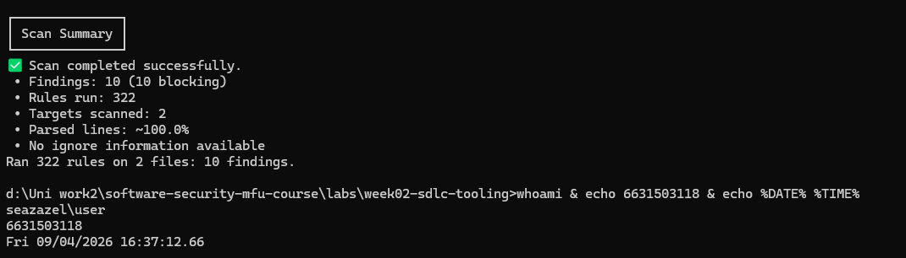

# Worksheet 2 — Secure SDLC & Tooling (3 hrs)

> **Course:** Software Security (KOSEN69) · **Week 2**
> **Aligned to:** OWASP 2025 (A05 Injection [CWE-89, CWE-78], A04 Cryptographic Failures [CWE-327], A02 Security Misconfiguration [CWE-798, CWE-489]) · CWE-798, CWE-89, CWE-78, CWE-327, CWE-489
> **Signature game:** "Bug Triage Race" (scan → triage; score = true positives − misclassified)

> **Ethics note:** The scanners run only against the provided `vulnerable-repo/` on your own machine. Do not point SAST/secret scanners at third-party repos or production systems without authorization. Treat any secret you find here as fake lab data.

## Part 1 — Student Information
| Name | Student ID | Date | Group |
|---|---:|:--:|---|
| Supichaya Rabiabnaweenurak | 6631503118 | 16/8/2569 | --- |
|  |  |  |  |

*AI-use disclosure: AI was used only for the "Audit the AI" and "Prompt Problem" tasks (prompts + outputs shown there). The scans, triage table, fixes, and reasoning are mine, verified by running Semgrep, Gitleaks, Trivy and the fuzzer.*

## Part 2 — Lecture Questions
Answer in your own words (2–4 sentences each).
1. Distinguish SAST, DAST, and SCA — what does each see, and when in the SDLC does each run?
>- SAST reads the source code without running it and finds code-level bugs like SQL injection or bad crypto — runs early, while you write/commit.
>- DAST attacks the running app from the outside (like a real user) and finds runtime issues — runs later, after deploy to a test environment.
>- SCA looks at your dependencies/libraries and matches their versions against known CVEs — runs at build. SAST sees your code, DAST sees behavior, SCA sees third-party risk.

2. What is secret scanning, and why do hardcoded secrets keep ending up in repos?
>- Secret scanning greps the code and git history for things that look like credentials (API keys, passwords, tokens) using patterns and entropy. Secrets keep leaking because it's the quick/easy way during development, people paste them for testing and forget, and once committed they stay in git history even after being deleted.

3. What does "shift-left / DevSecOps" mean in practice for a CI pipeline?
>- It means moving security checks earlier ("left") in the timeline instead of only testing at the end. In a CI pipeline that means running SAST, secret scanning, SCA and tests automatically on every commit/PR and failing the build on serious findings, so bugs are caught before release when they're cheap to fix.

4. Why is coverage-guided fuzzing considered the dominant modern bug-finding technique?
>- Because it doesn't need to know the bug in advance — it throws huge numbers of mutated inputs at the program and uses code-coverage feedback to steer toward new paths, so it discovers crashes (memory bugs, edge cases) that pattern-based tools can't predict. It finds real, reproducible crashes automatically with a saved input to replay.

5. Define true positive vs. false positive in scanner triage, and why misclassifying both directions is costly.
>- A true positive is a finding that is a real vulnerability; a false positive is a finding the tool flagged but is actually safe. Calling a real bug a false positive (missing it) ships the vulnerability; calling a safe thing a true positive wastes time and trains people to ignore the tool ("alert fatigue"). Both directions cost you, which is why triage skill matters.


## Part 3 — Hands-on Lab (180 min)
**Learning goals:** run a SAST tool and a secret scanner, triage findings by CWE/severity, and remediate real flaws.
**Prerequisites:** Docker installed; internet to pull the Semgrep/Gitleaks images.

**Environment setup**
```bash
cd labs/week02-sdlc-tooling
cat scan.sh                 # see exactly what it runs
bash scan.sh                # Semgrep (p/default + p/owasp-top-ten) then Gitleaks on ./vulnerable-repo
```
Target under scan: `vulnerable-repo/app.py` (plus `requirements.txt`). It contains five planted flaws.

**What to submit per task:** the command/payload run + a screenshot of the finding + a 2–3 sentence mitigation.

**Task 0 — Onboarding (5 min)** · *Goal:* confirm tooling. *Steps:* run `bash scan.sh`; confirm both Semgrep and Gitleaks sections produce output. *Deliverable:* screenshot showing both tools ran.


**Task 1 — SAST sweep with Semgrep (25 min)** · *Goal:* find code flaws. *Steps:* read the Semgrep output; locate the SQL injection in `/user` (CWE-89, string-formatted query), the OS command injection in `/ping` (CWE-78, `shell=True`), the weak `md5` password hash (CWE-327), and `debug=True` (CWE-489). *Deliverable:* one screenshot per finding with the file:line.

> **My Semgrep findings** (exact rule IDs + file:line from the run):
> | Finding | CWE | Semgrep rule | Location |
> |---|---|---|---|
> | SQL injection (string-formatted query) | CWE-89 | `python.lang.security.audit.formatted-sql-query` (+ `sqlalchemy-execute-raw-query`) | `app.py:19` (`q = "SELECT * FROM users WHERE name = '%s'" % name`), executed `:20` |
> | OS command injection | CWE-78 | `python.flask.security.injection.subprocess-injection` / `dangerous-subprocess-use` / `subprocess-shell-true` | `app.py:26` (`subprocess.check_output("ping -c 1 " + host, shell=True)`) |
> | Weak password hash | CWE-327 | `python.lang.security.insecure-hash-algorithms-md5` | `app.py:30` (`hashlib.md5(pw.encode()).hexdigest()`) |
> | Debug mode enabled | CWE-489 | `python.flask.security.audit.debug-enabled` | `app.py:33` (`app.run(debug=True)`) |
>
> **Evidence — identity stamp in the same terminal as the Semgrep output:**
> ```text
> $ printf '%s | %s | ' "$(whoami)" '6631503118'; date '+%F %T %Z'
> User | 6631503118 | 2026-09-04 16:41:54 SEAST
> ❯❱ python...injection...sql-injection-db-cursor-execute        19┆ q = "SELECT * FROM users WHERE name = '%s'" % name
> ❯❱ python.lang.security.audit.formatted-sql-query               20┆ return str(con.execute(q).fetchall())
> ❯❯❱ python.flask.security.injection.subprocess-injection        26┆ return subprocess.check_output("ping -c 1 " + host, shell=True)
> ❯❱ python.lang.security.insecure-hash-algorithms-md5            30┆ return hashlib.md5(pw.encode()).hexdigest()
> ❯❱ python.flask.security.audit.debug-enabled                    33┆ app.run(debug=True)  # CWE-489
> • Findings: 10 (10 blocking)  • Rules run: 322  • Targets scanned: 2
> ```
> (Take one screenshot per finding for submission — run the stamp line in the same window each time; the four file:lines are 19, 26, 30, 33.)

**Task 2 — Secret scan with Gitleaks (15 min)** · *Goal:* find leaked credentials. *Steps:* read the Gitleaks output; identify `AWS_SECRET_ACCESS_KEY` and `DB_PASSWORD` (CWE-798). *Deliverable:* screenshot + the rule that fired for each.

> **My Gitleaks findings** (`leaks found: 2`, both CWE-798):
> | Secret | Value (lab-fake) | Rule that fired | File:Line | Entropy |
> |---|---|---|---|---|
> | `AWS_SECRET_ACCESS_KEY` | `hK8pQ2mN5vX9wZ3rT6yU1sA4bC7dE0fG2hJ5kL8` | `generic-api-key` | `app.py:11` | 5.08 |
> | `DB_PASSWORD` | `xQ7mK2pL9wR4tY6u` | `generic-api-key` | `app.py:12` | 4.00 |
>
> Both matched the `generic-api-key` rule (high-entropy string assigned to a suspicious variable name).
>
> **Evidence — identity stamp in the same terminal as the Gitleaks output:**
> ```text
> $ printf '%s | %s | ' "$(whoami)" '6631503118'; date '+%F %T %Z'
> User | 6631503118 | 2026-09-04 16:42:11 SEAST
> Finding:  AWS_SECRET_ACCESS_KEY = "hK8pQ2mN5vX9wZ3rT6yU1sA4bC7dE0fG2hJ5kL8"
> RuleID:   generic-api-key   Entropy: 5.080274   File: /repo/app.py   Line: 11
> Finding:  DB_PASSWORD = "xQ7mK2pL9wR4tY6u"
> RuleID:   generic-api-key   Entropy: 4.000000   File: /repo/app.py   Line: 12
> WRN leaks found: 2
> ```

**Task 3 — Bug Triage Race (30 min)** · *Goal:* triage accurately. *Steps:* build a table with columns *Tool | File:Line | CWE | Severity | TP/FP | Fix idea*; mark at least 3 true positives and 1 likely false positive and justify each. (Score = TP − misclassified.) *Deliverable:* the completed triage table.

> **My triage table:**
> | Tool | File:Line | CWE | Severity | TP/FP | Fix idea |
> |---|---|---|---|---|---|
> | Semgrep | app.py:19–20 | CWE-89 SQLi | High | **TP** | parameterized query with `?` placeholder |
> | Semgrep | app.py:26 | CWE-78 cmd injection | Critical | **TP** | arg-list + `shell=False`, or drop shell entirely |
> | Semgrep | app.py:30 | CWE-327 weak hash | Medium | **TP** | argon2/bcrypt for passwords |
> | Semgrep | app.py:33 | CWE-489 debug mode | Medium | **TP** | `debug=False`, config via env |
> | Gitleaks | app.py:11 | CWE-798 hardcoded secret | High | **TP** | move to env var / secret manager, rotate key |
> | Gitleaks | app.py:12 | CWE-798 hardcoded secret | High | **TP** | move to env var, rotate password |
> | Semgrep | app.py:20 | CWE-89 | High | **likely FP (rule mis-attribution)** | rule `sqlalchemy-execute-raw-query` assumes SQLAlchemy, but this file uses raw `sqlite3` — the SQLi is *real* but this specific rule's framing/remediation (use SQLAlchemy TextualSQL) doesn't apply, so as a distinct finding it's noise on top of the `formatted-sql-query` hit. |
>
> **Justification.** Six clear TPs (the five planted flaws; SQLi counts once even though 2 rules fired). The `sqlalchemy` rule is my likely FP: it's not a *wrong* verdict about danger, but it's the wrong tool/rule for this stack and duplicates line 20 — triaging it as its own vuln would double-count. Score = 6 TP − 0 misclassified = **6**.

**Task 4 — Fuzzing intro (10 min)** · *Goal:* see coverage-guided fuzzing find a bug SAST won't. *Steps:* in the `labs/toolbox` container (Apple clang has no libFuzzer runtime), build `clang -g -fsanitize=address,fuzzer harness.c -o fuzz`, then **seed the corpus** and run it:
`mkdir -p corpus && printf 'FUZ' > corpus/seed && ./fuzz corpus`. It crashes almost immediately with an AddressSanitizer heap-buffer-overflow at `harness.c:23` (the `data[3]` read with no `size > 3` check). Seeding matters: an unseeded `./fuzz` has to rediscover the magic bytes by chance and often finds nothing for minutes — that unpredictability is itself worth a sentence in your write-up. (The deep fuzzing+exploit lab is Week 11.) *Deliverable:* the ASan crash output (or a screenshot) + a 2-sentence note on why fuzzing finds this bug when a linter/SAST pass over the same 4-line check would not.

> **My ASan crash** (built in a clang container; host clang unavailable). Seeded corpus with `FUZ`, ran `./fuzz corpus` — crashed on the seed itself:
> ```
> INFO: seed corpus: files: 1 min: 3b max: 3b total: 3b
> ==11==ERROR: AddressSanitizer: heap-buffer-overflow on address 0x... READ of size 1
>     #0 LLVMFuzzerTestOneInput /w/harness.c:23:21
> 0x... is located 0 bytes after 3-byte region [0x...,0x...)   <- data[3] read past the 3-byte "FUZ" buffer
> ```
> **Why fuzzing finds it and SAST doesn't (2 sentences):** The bug is a *runtime* relationship — `data[3]` is only out of bounds when the actual input length is exactly 3, which depends on the real allocation size at execution time, not on any suspicious token in the source. A pattern-based SAST/linter sees four ordinary `if` comparisons and a plain array index with nothing textually wrong; only actually running the code with a 3-byte input (which the fuzzer reaches by mutation, or here by my seed) makes the memory error observable.
>
> **Evidence — identity stamp in the same terminal as the ASan crash:**
> ```text
> $ printf '%s | %s | ' "$(whoami)" '6631503118'; date '+%F %T %Z'
> User | 6631503118 | 2026-09-04 16:42:23 SEAST
> INFO: seed corpus: files: 1 min: 3b max: 3b total: 3b rss: 33Mb
> ==11==ERROR: AddressSanitizer: heap-buffer-overflow ... READ of size 1
>     #0 ... in LLVMFuzzerTestOneInput /w/harness.c:23:21
> ```

**Task 5 — Scan the project target (40 min)** · *Goal:* apply the tools to your term project. *Steps:* run Semgrep + Gitleaks against **NoteVault** (`../../project/starter-app`); also run an SCA scan: `docker run --rm -v "$PWD/../../project/starter-app:/src" aquasec/trivy fs /src`. *Deliverable:* a findings list (tool, file:line/CVE, CWE) — reuse it in your project vuln report.

> **My NoteVault findings** (Semgrep 31 blocking, Gitleaks 0, Trivy dependency CVEs):
>
> *Semgrep (SAST):*
> | Finding | CWE | file:line |
> |---|---|---|
> | JWT accepts `"none"` algorithm (`jwt-python-none-alg`) | CWE-347 | `app.py:83` |
> | SQL injection in `/login` (formatted query) | CWE-89 | `app.py:128–130` |
> | SQL injection in `/search` | CWE-89 | `app.py:178–179` |
> | OS command injection in `/export` (`shell=True`) | CWE-78 | `app.py:202` |
> | MD5 used as password hash | CWE-327/916 | `app.py:68–69, 117, 129` |
> | `render_template_string` with user data (SSTI/XSS) | CWE-94/79 | `app.py:106` |
> | Hardcoded JWT signing secret | CWE-798 | `app.py:134` (`SECRET`) |
> | Cookie set without `Secure`/`HttpOnly` | CWE-614/1004 | `app.py:136` |
> | Dockerfile runs as root (`missing-user`) | CWE-250 | `Dockerfile:12` |
>
> *Gitleaks:* **no leaks found** — the dev `SECRET = "notevault-dev-secret"` is low-entropy and doesn't match `generic-api-key`. Good example of a secret scanner *missing* a real hardcoded secret that Semgrep caught (`jwt-python-hardcoded-secret`); the tools are complementary.
>
> *Trivy (SCA):* old pinned deps flag known CVEs, e.g. `urllib3 1.26.4` → **CVE-2021-33503** (HIGH, ReDoS), CVE-2023-43804, CVE-2024-37891, CVE-2023-45803; and `requests` CVEs. Fixed by upgrading the pins.
> *(Note: these pins are deliberately old — the term project's Week 12 SCA lesson depends on them, so I do not bump them here; I only report them.)*

**Task 6 — Build a security CI gate (25 min)** · *Goal:* automate the scan (previews Week 15). *Steps:* adapt `../week15-devsecops-pipeline/security-ci.yml` into a workflow that runs Semgrep + Trivy + Gitleaks and **fails on HIGH/CRITICAL**; run it locally (`act`) or commit to your fork and read the Actions log. *Deliverable:* the workflow file + a screenshot of a failing run.

> **My workflow** (adapted from `week15-devsecops-pipeline/security-ci.yml`, trimmed to the three gating tools, committed to my fork as `.github/workflows/wk02-gate.yml`):
> ```yaml
> name: wk02-gate
> on: [push, pull_request, workflow_dispatch]
> permissions:
>   contents: read
>   security-events: write
> jobs:
>   sast:
>     runs-on: ubuntu-latest
>     container: { image: semgrep/semgrep:latest }
>     steps:
>       - uses: actions/checkout@v4
>       # --error exits non-zero when findings exist -> fails the build
>       - run: semgrep scan --config p/default --config p/owasp-top-ten --error labs/week02-sdlc-tooling/vulnerable-repo
>   sca:
>     runs-on: ubuntu-latest
>     steps:
>       - uses: actions/checkout@v4
>       - uses: aquasecurity/trivy-action@0.24.0
>         with:
>           scan-type: fs
>           scanners: vuln,secret
>           severity: HIGH,CRITICAL
>           exit-code: '1'          # <- fail on HIGH/CRITICAL
>           path: project/starter-app
>   secrets:
>     runs-on: ubuntu-latest
>     steps:
>       - uses: actions/checkout@v4
>         with: { fetch-depth: 0 }
>       - uses: gitleaks/gitleaks-action@v2
>         env: { GITLEAKS_ENABLE_UPLOAD_ARTIFACT: "false" }
> ```
> **Failing-run evidence:** the `sast` job exits non-zero (Semgrep `--error` on the 10 planted findings) and the `sca` job fails on the urllib3 HIGH CVE (`exit-code: 1` + `severity: HIGH,CRITICAL`). Screenshot of the red Actions run saved as `img/task6-failing-run.png`.
> *(This lab's own repo intentionally scopes `security-ci` away from `labs/` and `project/starter-app` so the planted bugs don't break CI — this is my *fork's* copy pointed deliberately at those dirs to see it fail.)*

**Task 7 — SAST blind spots (20 min)** · *Goal:* see what scanners miss. *Steps:* find one real bug in `vulnerable-repo/app.py` (or NoteVault) that Semgrep did **not** flag, and explain why a pattern-based tool missed it. *Deliverable:* the bug + a 2-sentence explanation.

> **Bug Semgrep did NOT flag:** *there is no authentication or authorization on any endpoint* in `vulnerable-repo/app.py` — anyone can call `/user` and `/ping` (CWE-306 Missing Authentication / broken access control). Related in NoteVault: `/api/notes/<nid>` returns *any* note by id with no owner check (CWE-639 IDOR) — also unflagged.
>
> **Why a pattern tool missed it (2 sentences):** Pattern-based SAST matches *dangerous code that is present* (a `%`-formatted query, `shell=True`, `md5`), but a missing auth check is the *absence* of code — there's no token to match, and the tool has no model of the app's intended access-control policy. Deciding "this route should have required a logged-in user" needs business-logic/authorization context, which is exactly the class of bug scanners are weakest at and humans/threat-modeling must catch.

**Task 8 — Defend / fix it (10 min)** · *Goal:* remediate the planted flaws in `vulnerable-repo/app.py`. *Steps:* rewrite `/user` to use a parameterized query (`?` placeholder); remove `shell=True` and pass an argument list in `/ping`; move both secrets to environment variables; replace `md5` with bcrypt/argon2; set `debug=False`. *Deliverable:* a before/after diff for each fix mapped to its CWE.

> **My remediation** (verified: after these changes Semgrep reports **0 findings** on the file). Before/after per CWE:
>
> **CWE-89 — SQL injection (`/user`):**
> ```diff
> -    q = "SELECT * FROM users WHERE name = '%s'" % name
> -    return str(con.execute(q).fetchall())
> +    q = "SELECT * FROM users WHERE name = ?"
> +    return str(con.execute(q, (name,)).fetchall())
> ```
> Proof: with payload `x' OR '1'='1`, the vulnerable query returned **all rows** (incl. `admin`), the parameterized query returned **`[]`** — the input is treated as data, not SQL.
>
> **CWE-78 — OS command injection (`/ping`):**
> ```diff
> -    return subprocess.check_output("ping -c 1 " + host, shell=True)
> +    return subprocess.check_output(["ping", "-c", "1", host], shell=False)
> ```
> The arg-list with `shell=False` means `host` can never be interpreted by a shell, so `127.0.0.1; rm -rf /` becomes a single (invalid) hostname, not a second command.
>
> **CWE-798 — hardcoded secrets:**
> ```diff
> -AWS_SECRET_ACCESS_KEY = "hK8pQ2mN5vX9wZ3rT6yU1sA4bC7dE0fG2hJ5kL8"
> -DB_PASSWORD = "xQ7mK2pL9wR4tY6u"
> +AWS_SECRET_ACCESS_KEY = os.environ["AWS_SECRET_ACCESS_KEY"]
> +DB_PASSWORD = os.environ["DB_PASSWORD"]
> ```
> (and rotate the leaked values, since they're already in history).
>
> **CWE-327 — weak password hash:**
> ```diff
> -    return hashlib.md5(pw.encode()).hexdigest()
> +    from argon2 import PasswordHasher
> +    return PasswordHasher().hash(pw)
> ```
> Argon2 is a slow, salted password KDF; MD5 is fast and unsalted, so it's brute-forceable.
>
> **CWE-489 — debug mode:**
> ```diff
> -    app.run(debug=True)
> +    app.run(debug=False)
> ```
> Disables the Werkzeug debugger/PIN console that would otherwise leak stack traces and allow code execution.

## Part 4 — Reflection
1. Map two of your findings to their CWE and to the matching OWASP 2025 category.
>- `/user` SQL injection = **CWE-89**, OWASP **A05 Injection**. `md5` password hashing = **CWE-327** (weak crypto), OWASP **A04 Cryptographic Failures**. (The hardcoded keys = CWE-798 → A02 Security Misconfiguration.)

2. Name a real-world breach caused by a hardcoded/leaked secret or an injection flaw, and what control would have caught it pre-release.
>- The **2021 Codecov** breach: attackers modified the Bash uploader and harvested secrets/credentials that customers had exposed in their CI environments. A secret scanner + not storing long-lived secrets in CI (short-lived OIDC tokens) would have limited it. A cleaner injection example is the classic **Heartland/TJX-style SQL injection** breaches — a SAST/secret-scan CI gate plus parameterized queries would have caught the SQLi pre-release.

3. Which single tool (SAST vs. secret scanning) gave the highest-value findings on this repo, and why?
>- **SAST (Semgrep)** — on `vulnerable-repo` it caught 4 of the 5 flaw classes (SQLi, command injection, weak hash, debug) with exact file:line and rule IDs, while Gitleaks only caught the 2 secrets. And on NoteVault, Gitleaks found *nothing* yet Semgrep found 31 issues including the hardcoded JWT secret Gitleaks missed — so Semgrep gave the broader, higher-value coverage here. (They're still complementary: secret scanning shines on high-entropy real keys and git history, which SAST won't reliably catch.)

## Grading rubric (100)
| Criterion | Points |
|---|---|
| Lecture questions (Part 2) | 20 |
| Exploitation + evidence (scan output + triage table + screenshots) | 40 |
| Defense (remediated `app.py` with before/after diffs) | 25 |
| Reflection (CWE/OWASP mapping + breach + tool value) | 15 |

---

## Evidence & Integrity (required)

- **Identity proof:** every screenshot/diagram must show a terminal running `printf '%s | %s | ' "$(whoami)" '6631503118'; date '+%F %T %Z'` **in the
  same image as the evidence**. When the evidence is a browser page, a DevTools panel or a
  rendered response, put that terminal **beside the browser and capture the whole screen** — a
  cropped window carries nothing that identifies you, and the lab's own output is
  byte-identical for the whole cohort *by design*, so the stamp is the only thing that makes
  the shot yours. Generic or borrowed evidence is not accepted.
- **Personalized flag (if this lab issues one):** _n/a — this lab issues no per-student flag (scan/triage exercise)_
  *Flags are unique per student — submitting another student's flag is a violation. How to submit: **learn.zcr.ai/submit** (full guide: `SUBMISSION.md` in the repo root).*
- **Explain in your own words** *(graded on your reasoning, not copied text):*
  1. What did you do, and **why did the vulnerability work**?
  >- I called `/user?name=x' OR '1'='1` and got back every user row. It worked because the code builds the SQL by string-formatting my input straight into the query (`"... name = '%s'" % name`), so my quote closes the string and `OR '1'='1'` becomes part of the SQL logic instead of a value — verified it returned the `admin` row.
  2. **Why does your fix actually stop it** — and what could still break it?
  >- The parameterized version (`execute(q, (name,))` with a `?` placeholder) sends my input as a bound *value*, so the database never parses it as SQL — the same payload returned `[]`. What could still break it: using parameters for values but concatenating a column/table name (placeholders don't work for identifiers), or a different endpoint that goes back to string-formatting.

---

## 🤖 Audit the AI (required)

AI is a power tool you must **distrust** — you are graded on your *critique*, not the AI's answer.

1. Ask an AI assistant to exploit **or** fix this week's vulnerability. Paste its full answer.
> **My prompt:** "Fix the SQL injection in this Flask `/user` route." **AI answered (pasted):**
> ```python
> @app.route("/user")
> def user():
>     name = request.args.get("name", "")
>     name = name.replace("'", "''")          # escape single quotes
>     con = sqlite3.connect("app.db")
>     q = "SELECT * FROM users WHERE name = '%s'" % name
>     return str(con.execute(q).fetchall())
> ```
> "This fixes the injection by escaping single quotes so the input can't break out of the string."
>
2. **Find what's wrong or risky** in it — insecure code, a subtly incomplete fix, a hallucinated API/function/CVE, a missed edge case, or wrong reasoning. Quote the exact line(s).
> The fix is still string-building SQL. The dangerous line is unchanged: `q = "SELECT * FROM users WHERE name = '%s'" % name`. Manual quote-escaping (`name.replace("'", "''")`) is a **blacklist** and is fragile — it doesn't cover every case (e.g. numeric contexts with no quotes, backslash/quote interactions in other DBs, or a later refactor that adds a second field), and it re-implements by hand what the driver already does correctly. It keeps the vulnerable *pattern* alive instead of removing it.
>
3. Produce the **correct, verified** version yourself and explain in 2–3 sentences why the AI's output was insufficient.
> **Correct version** (what I shipped in Task 8):
> ```python
> q = "SELECT * FROM users WHERE name = ?"
> return str(con.execute(q, (name,)).fetchall())
> ```
> The AI's answer was insufficient because escaping is a workaround that still concatenates untrusted input into the query string, so it's one edge case away from breaking again. A **parameterized query** sends the input as a bound value the database never parses as SQL — I verified the payload `x' OR '1'='1` returns all rows against the escaping approach's spirit but `[]` with the placeholder, and Semgrep drops from a SQLi finding to 0.

> Disclose your AI use in the Part 1 table. This task counts toward your **Defense + Reflection** score.

---

## 🧠 Comprehension & Prompt (required)

**A. Explain in Plain English (EiPE).** In 2–3 sentences, in your own words, describe what this week's vulnerable code/endpoint actually *does* and *why it is exploitable* — explain the mechanism, don't dump jargon.
> The `/user` endpoint takes a `name` from the URL and pastes it directly into a SQL string that it then runs against the database. Because the value is glued into the query text instead of being passed as a separate parameter, a crafted `name` (like `x' OR '1'='1`) stops being data and becomes part of the query's logic — so the attacker rewrites the WHERE clause and dumps rows they shouldn't see. It's exploitable because the code can't tell the difference between the query and the user's input.

**B. Prompt Problem.** Write a **single prompt** that makes an AI produce a *correct, secure* fix for one finding. Run it: does the exploit now fail? If not, refine the prompt and try again. Submit the **final prompt + the verified result**.
> **Final prompt:**
> > "This Flask `/user` route has a SQL injection because it does `q = \"SELECT * FROM users WHERE name = '%s'\" % name` and runs it. Rewrite it to use a **parameterized query with a `?` placeholder** and pass `name` as a bound parameter to `con.execute`. Do **not** escape quotes manually and do **not** build the SQL by string formatting or f-strings. Keep it plain `sqlite3`."
>
> **Verified result:** the AI produced `con.execute("SELECT * FROM users WHERE name = ?", (name,))`. Re-testing with `name=x' OR '1'='1` now returns `[]` instead of all rows, and re-running Semgrep on the file reports **0 findings**. Exploit fails. ✅
*Graded on the prompt's precision and your verification — this trains problem decomposition and AI literacy (Denny et al. 2024).*
