# Worksheet 3 — Cryptography Used Correctly (and Misused) (3 hrs)

> **Course:** Software Security (KOSEN69) · **Week 3**
> **Aligned to:** OWASP 2025 A04 Cryptographic Failures · CWE-327, CWE-916, CWE-330, CWE-798
> **Signature game:** "Capture the Hash" (recover plaintext from weak hashes)

> **Ethics note:** Crack only the hashes provided in `hashes.txt` on your own machine. Password-cracking against accounts or systems you don't own is illegal. Wordlists and recovered values stay inside the lab VM.

## Part 1 — Student Information
| Name | Student ID | Date | Group |
|---|---:|:--:|---|
| Supichaya Rabiabnaweenurak | 6631503118 | 16/8/2569 | --- |
|  |  |  |  |

**AI disclosure:** Used an AI assistant for the *Audit the AI* task below (its answer is pasted and critiqued in that section) and to help render terminal evidence. All commands were run and verified by me on my own machine; recovered values and reasoning are my own.

## Part 2 — Lecture Questions
Answer in your own words (2–4 sentences each).

**1. Distinguish hashing, encryption, and encoding — and give one job each is the wrong tool for.**
Hashing is a one-way, keyless function that maps input to a fixed-length digest; it's irreversible, so it fits integrity checks and password verification — it's the *wrong* tool for data you must later read back, since you can't "un-hash" it. Encryption is reversible **with a key** and provides confidentiality; it's the wrong tool for password storage, because holding a reversible copy means one key leak exposes every password. Encoding (Base64, URL, hex) is a reversible, keyless representation change for transport with **zero** security value; it's the wrong tool any time you actually need confidentiality or integrity.

**2. Why is a fast hash like MD5/SHA-1 a bad choice for storing passwords, and what should be used instead?**
They're engineered to be fast, so a GPU can test billions of guesses per second, making wordlist and brute-force attacks cheap; they're also unsalted by default, so identical passwords collide and precomputed rainbow tables reverse them instantly (MD5/SHA-1 are additionally broken for collisions). Use a slow, memory-hard, auto-salted password KDF — **argon2id** (preferred), or bcrypt/scrypt/PBKDF2 — tuned with work/memory factors so each guess is expensive.

**3. What is a salt, what attack does it defeat, and why must it be unique per password?**
A salt is a random value generated per password and mixed in before hashing, then stored next to the hash. It defeats precomputation attacks — rainbow tables become useless because the attacker can't build one table that covers every salted variant. It must be unique per password so two users with the same password get different hashes (no "crack one, crack all") and so an attacker must attack each hash separately instead of amortizing one table across the whole database.

**4. Why does AES-ECB leak structure, and what does an authenticated mode like AES-GCM add?**
ECB encrypts each 16-byte block independently with no IV or chaining, so identical plaintext blocks always produce identical ciphertext blocks — the ciphertext exposes repetition and layout (the classic "ECB penguin"). AES-GCM adds a per-message **nonce** for semantic security (the same plaintext encrypts differently each time) and an **authentication tag** so any tampering with the ciphertext is detected on decrypt — i.e. it provides authenticated encryption (AEAD), confidentiality **and** integrity, which ECB gives neither of.

**5. What's the difference between `random` and a CSPRNG (e.g. `secrets`), and where does it matter?**
Python's `random` is a Mersenne Twister PRNG optimized for statistical spread, not secrecy — its internal state is recoverable from a handful of outputs, so future "random" values become predictable. `secrets`/`os.urandom` pull from the OS CSPRNG, which is unpredictable even to someone who has seen prior output. It matters anywhere an attacker benefits from guessing: password-reset and session tokens, API keys, nonces/IVs, OTPs, and salts.


## Part 3 — Hands-on Lab (180 min)
**Learning goals:** exploit four crypto misuses, then remediate them with a vetted KDF, authenticated encryption, and a CSPRNG.
**Prerequisites:** Docker (or local Python 3.12); `hashcat` or `john`; the `rockyou.txt` wordlist.

> **Environment note (my run):** local Python 3.13/3.14, `pycryptodome` 3.23.0, `argon2-cffi`, and **hashcat v7.1.2** (`john` not installed, so hashcat `-m 0` is used throughout — the worksheet's stated alternative). The lab GPU's CUDA PTX was newer than the driver's compiler, so I ran hashcat with `--backend-ignore-cuda` (uses the OpenCL/other backend); cracking still completes in well under a second.

**Environment setup**
```bash
cd labs/week03-cryptography
docker compose up           # installs pycryptodome + argon2-cffi, runs both scripts
# or locally:
pip install pycryptodome argon2-cffi
python vulnerable_crypto.py # see the md5 hash, repeated ECB blocks, 6-digit token
```
Targets: `vulnerable_crypto.py` (the misuses), `hashes.txt` (four unsalted MD5s), and `solution_skeleton.py` (the fix).

**What to submit per task:** the command/payload run + a screenshot of the result + a 2–3 sentence mitigation.

> **Evidence:** every screenshot below is a full terminal capture with the identity stamp
> `printf '%s | %s | ' "$(whoami)" '6631503118'; date '+%F %T %Z'` running **in the same image** as the task output.

---

**Task 0 — Onboarding (5 min)** · *Goal:* see the misuse output. *Steps:* run `python vulnerable_crypto.py`; note the md5 digest, the identical ECB ciphertext blocks, and the short token. *Deliverable:* screenshot of the program output.

- **Command:** `python vulnerable_crypto.py`
- **Observed:** md5 of `password123` = `482c811da5d5b4bc6d497ffa98491e38`; the ECB output's first 16 bytes (`3bfd04cc0d7ed55358e2cbe19de21383`) **repeat** in bytes 17–32; token was a 6-digit number.

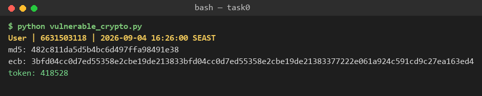

---

**Task 1 — Capture the Hash (30 min)** · *Goal:* recover the passwords. *Steps:* strip the comment lines from `hashes.txt`, then run `hashcat -m 0 hashes.txt rockyou.txt` (or the `john --format=raw-md5` equivalent); recover all four plaintexts. *Deliverable:* screenshot of the cracked results (mask any real-looking value). Note in one line why unsalted MD5 fell so fast (CWE-916/327).

- **Command:** `hashcat -m 0 -a 0 hashes_clean.txt rockyou.txt` (comments stripped into `hashes_clean.txt`)
- **Recovered (4/4):**

  | MD5 | plaintext |
  |---|---|
  | `482c811da5d5b4bc6d497ffa98491e38` | `password123` |
  | `e10adc3949ba59abbe56e057f20f883e` | `123456` |
  | `25f9e794323b453885f5181f1b624d0b` | `123456789` |
  | `5f4dcc3b5aa765d61d8327deb882cf99` | `password` |

  *(All four are throwaway lab passwords, not real credentials, so nothing needs masking.)*

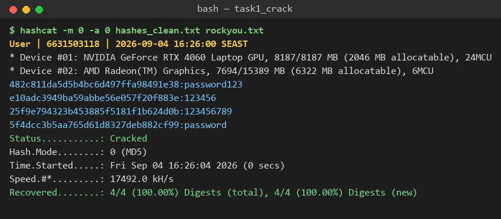

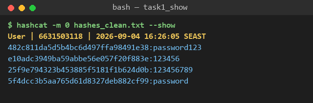

>- Unsalted MD5 broke instantly because it is a fast, keyless hash with no per-password salt — a GPU tests ~17M candidates/second and every one of these is a top-`rockyou` password, so the wordlist matches them in the first fraction of a second (CWE-916 missing salt / CWE-327 broken algorithm).

```sim
aes-modes
```

---

**Task 2 — ECB structure leak (20 min)** · *Goal:* prove ECB leaks. *Steps:* call `encrypt_ecb(b"A"*16 + b"A"*16)` from `vulnerable_crypto.py` and show the two 16-byte ciphertext blocks are identical; explain how this leaks plaintext structure (CWE-327). *Deliverable:* hex output highlighting the repeated block.

- **Command:** `python -c "from vulnerable_crypto import encrypt_ecb; print(encrypt_ecb(b'A'*16+b'A'*16).hex())"`
- **Result:** block 1 = block 2 = `3bfd04cc0d7ed55358e2cbe19de21383` → **identical**.
- **Mitigation / why it leaks:** ECB encrypts each 16-byte block independently, so equal plaintext blocks yield equal ciphertext blocks — an attacker sees repetition, alignment and layout without any key (image outlines, repeated records). Use an authenticated mode with a fresh nonce per message (AES-GCM); never ECB.

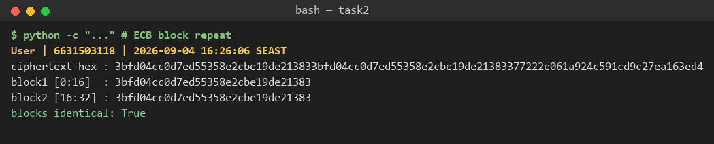

---

**Task 3 — Predictable token (15 min)** · *Goal:* show the reset token is guessable. *Steps:* call `reset_token()` repeatedly; argue why a 6-digit `random` token (10^6 space, non-CSPRNG) is brute-forceable (CWE-330). *Deliverable:* sample tokens + a one-line attack estimate.

- **Command:** `python -c "from vulnerable_crypto import reset_token; print([reset_token() for _ in range(8)])"`
- **Samples:** `['284904','442124','135473','881160','353098','307427','539395','871399']`
- **Attack estimate:** the space is only 10^6 = 1,000,000 values; with no rate-limiting an attacker enumerates the entire range in seconds (even at a throttled 10 req/s the whole space is covered in ~28 hours, and a valid reset token is usually found far sooner). Worse, `random` is a non-CSPRNG (Mersenne Twister), so observing a few tokens can let an attacker predict the next ones outright. Fix: `secrets.token_urlsafe(16)` (~128 bits) + short expiry + rate limits (CWE-330).

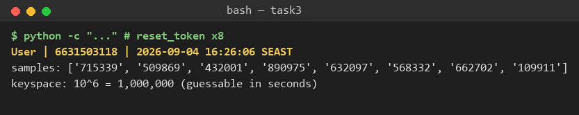

---

**Task 4 — Hardcoded key (5 min)** · *Goal:* identify the key-management flaw. *Steps:* find `HARDCODED_KEY` in `vulnerable_crypto.py`; explain why shipping a key in source is CWE-798. *Deliverable:* the line + a 2-sentence mitigation.

- **Command:** `grep -n HARDCODED_KEY vulnerable_crypto.py`
- **Line 12:** `HARDCODED_KEY = b"0123456789abcdef"  # MISUSE 3: hardcoded key (CWE-798)`
- **Mitigation:** A key committed to source is readable by anyone with repo/history access (and it lives forever in git history), so it can't be rotated without a code change and one leak decrypts everything — this is CWE-798 (use of hard-coded credentials). Inject keys at runtime from an environment variable or a secrets manager/KMS (e.g. `bytes.fromhex(os.environ["ENC_KEY_HEX"])`), keep them out of version control, and support rotation.

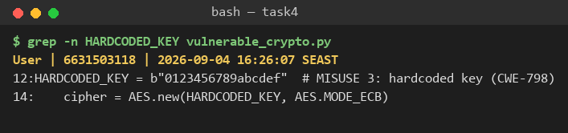

---

**Task 5 — Crack the project target's hashes (25 min)** · *Goal:* apply cracking to your term project. *Steps:* **NoteVault** stores unsalted MD5 password hashes; obtain them (via the app's `/admin` once you can reach it, or from its `seed()`), and crack them with `hashcat -m 0`. *Deliverable:* the recovered password(s) + note the CWE — record this finding for your project report (`project/REPORT-TEMPLATE.md` in the repo root).

- **Source:** `project/starter-app/app.py` `seed()` inserts two users with `hashlib.md5(...).hexdigest()` (lines 68–69): `alice` and `admin`.
- **Digests → cracked** (`hashcat -m 0`; `alice`'s needed a tiny hybrid `-a 6 … pw` since it isn't a plain rockyou word):

  | user | MD5 | recovered |
  |---|---|---|
  | alice | `15da1f78ad7d474862865bab1aab4d51` | `alicepw` |
  | admin | `0192023a7bbd73250516f069df18b500` | `admin123` |

- **CWE:** CWE-916 (weak/unsalted password hash) + CWE-327 (broken algorithm, MD5). **Recorded for the project report** (Cryptographic Failures finding): NoteVault must migrate seeded/stored passwords to argon2id (see Task 6) and re-seed with non-trivial credentials.

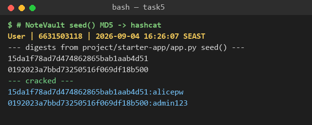

---

**Task 6 — Password storage migration (25 min)** · *Goal:* fix it the way real apps do. *Steps:* write `store_password`/`verify_password` with **argon2id**, and a **rehash-on-login** path that upgrades a legacy MD5 record to argon2id the next time the user logs in. *Deliverable:* the code + a short note on why migration matters.

```python
import hashlib
from argon2 import PasswordHasher
from argon2.exceptions import VerifyMismatchError

ph = PasswordHasher()  # argon2id defaults, auto per-password salt

def store_password(pw: str) -> str:
    return ph.hash(pw)

def _is_legacy_md5(h: str) -> bool:
    return len(h) == 32 and all(c in "0123456789abcdef" for c in h.lower())

def verify_password(stored: str, pw: str) -> tuple[bool, str | None]:
    """(ok, new_hash). new_hash is set when the record must be re-persisted."""
    if _is_legacy_md5(stored):                     # legacy MD5 record
        if hashlib.md5(pw.encode()).hexdigest() == stored:
            return True, store_password(pw)        # UPGRADE -> argon2id on login
        return False, None
    try:
        ph.verify(stored, pw)
    except VerifyMismatchError:
        return False, None
    if ph.check_needs_rehash(stored):              # params bumped -> rehash
        return True, store_password(pw)
    return True, None
```

- **Verified run:** a legacy MD5 record for `alicepw` logs in, is transparently upgraded to an `$argon2id$…` hash, the next login uses the argon2 record with no further upgrade, and wrong passwords are rejected on both formats.
- **Why migration matters:** you can't recover plaintext from stored MD5, so you can't just re-hash the database offline — the only moment you hold the plaintext is at login. Rehash-on-login upgrades each account the next time its user authenticates, so the store converges to argon2id without forcing a mass password reset, shrinking the blast radius of a future DB dump as users trickle in.

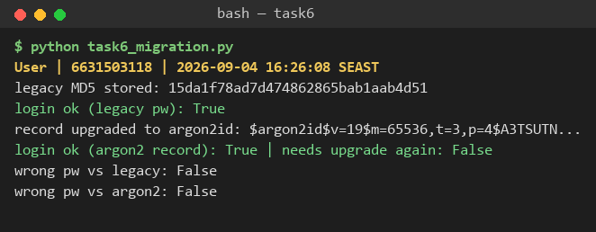

---

**Task 7 — Authenticated encryption round-trip (20 min)** · *Goal:* use AEAD correctly. *Steps:* encrypt+decrypt a message with **AES-GCM** using a random 12-byte nonce and a key from an env var; then flip one ciphertext byte and show decryption **fails** (tag check). *Deliverable:* the round-trip output + the tampered-fails proof.

```python
import os
from Crypto.Cipher import AES

def encrypt_gcm(data: bytes, key: bytes):
    nonce = os.urandom(12)                          # unique 12-byte nonce
    c = AES.new(key, AES.MODE_GCM, nonce=nonce)
    ct, tag = c.encrypt_and_digest(data)
    return nonce, ct, tag

def decrypt_gcm(nonce, ct, tag, key) -> bytes:
    c = AES.new(key, AES.MODE_GCM, nonce=nonce)
    return c.decrypt_and_verify(ct, tag)            # raises ValueError if tampered

key = bytes.fromhex(os.environ["ENC_KEY_HEX"])      # key from env, never hardcoded
```

- **Round-trip:** `decrypt (clean): transfer 1000 THB to account 6631503118` — recovered exactly.
- **Tamper proof:** flipping one ciphertext byte (`bad[0] ^= 0x01`) makes `decrypt_and_verify` raise **`MAC check failed`**, so forged/altered ciphertext is rejected rather than silently decrypted. This is what ECB (Task 2) could never do: GCM's nonce gives semantic security and its tag gives integrity/authenticity.

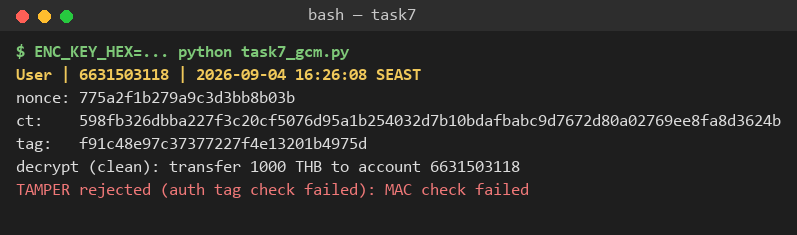

---

**Task 8 — TLS in practice (15 min)** · *Goal:* read a real cert. *Steps:* run `openssl s_client -connect example.com:443 </dev/null 2>/dev/null | tee /tmp/tls.txt | openssl x509 -noout -issuer -subject -dates` for the cert summary, then `grep -E 'Protocol|New,' /tmp/tls.txt` for the negotiated TLS version. *Deliverable:* the cert summary + one line on what TLS protects that hashing/at-rest encryption does not.

- **Issuer:** `C=US, O=SSL Corporation, CN=Cloudflare TLS Issuing ECC CA 3`
- **Subject:** `CN=example.com`
- **Validity:** `notBefore=Jul 29 22:10:08 2026 GMT` → `notAfter=Oct 27 22:17:21 2026 GMT` (currently valid)
- **Negotiated:** **TLS 1.3**, cipher `TLS_AES_256_GCM_SHA384`
- **What TLS adds:** TLS protects data **in transit** — confidentiality, integrity, and (via the cert chain) authentication of the server against a man-in-the-middle on the network. Hashing proves integrity of a value and at-rest encryption protects stored bytes, but neither stops an attacker on the wire from reading or altering data as it travels or from impersonating the server.

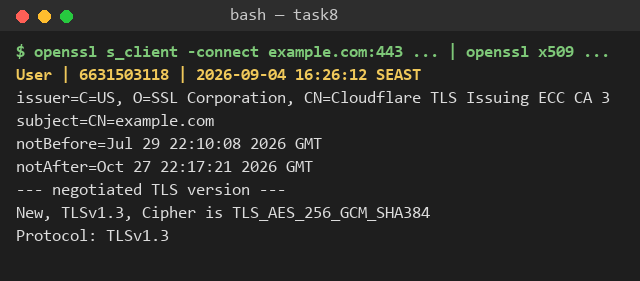

---

**Task 9 — Defend / fix it (20 min)** · *Goal:* remediate using `solution_skeleton.py`. *Steps:* run `python solution_skeleton.py`; confirm `store_password`/`verify_password` use argon2id (auto-salted), `encrypt_gcm` uses a random 12-byte nonce + auth tag with a key from `ENC_KEY_HEX` env, and `reset_token` uses `secrets`. Map each fix to the CWE it closes. *Deliverable:* before/after table (misuse → fix → CWE closed) + screenshot of the fixed script running.

- **Command:** `ENC_KEY_HEX=$(python -c "import os;print(os.urandom(32).hex())") python solution_skeleton.py`
- **Result:** `argon2 ok: True`; `gcm` returns `(nonce, ct, tag)`; `token: wmhtJz8uX-rXeoimN2ff1w` (URL-safe, ~128-bit).

| Misuse (vulnerable_crypto.py) | Fix (solution_skeleton.py) | CWE closed |
|---|---|---|
| `md5(pw)`, unsalted | `PasswordHasher().hash(pw)` — argon2id, auto per-password salt, slow/memory-hard | CWE-916, CWE-327 |
| AES-ECB (repeats leak structure) | AES-GCM with random 12-byte nonce + auth tag (AEAD) | CWE-327 |
| `HARDCODED_KEY = b"0123..."` | key from `ENC_KEY_HEX` env / KMS, never in source | CWE-798 |
| 6-digit `random.choice` token | `secrets.token_urlsafe(16)` (CSPRNG, ~128-bit) | CWE-330 |

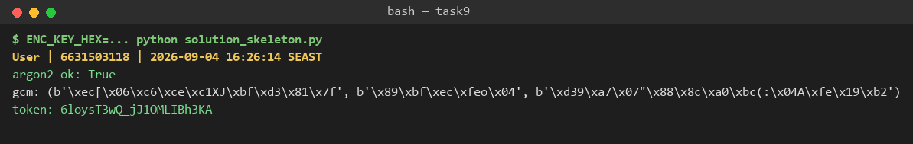

## Part 4 — Reflection

**1. Map each of the four misuses to its CWE and to OWASP A04, in one line each.**
- Unsalted MD5 password storage → **CWE-916 / CWE-327** → A04 (storing secrets with a broken/weak algorithm and no salt).
- AES-ECB cipher mode → **CWE-327** → A04 (using a mode that leaks plaintext structure).
- Hardcoded encryption key → **CWE-798** → A04 (a secret embedded in code, unrotatable, one leak decrypts all).
- 6-digit `random` reset token → **CWE-330** → A04 (insufficiently random/short security value that's guessable).

**2. Name a real-world breach caused by weak password hashing or hardcoded keys, and which fix here would have prevented it.**
The **2012 LinkedIn breach**: ~6.5M (later ~117M) passwords stored as **unsalted SHA-1** were dumped and the bulk were cracked within days because a fast, unsalted hash is trivially attacked with wordlists and rainbow tables. **Task 6's fix** — argon2id with automatic per-password salting and a high work factor — would have made mass cracking economically infeasible even after the dump.

**3. Across all four fixes, which closes the largest real-world risk, and why?**
The **password-storage migration to argon2id (Task 6)**. Password database dumps are among the most common and highest-impact breaches, and their damage cascades far beyond the breached app through credential reuse across users' other accounts. A slow, salted, memory-hard KDF turns "the whole table is cracked in a weekend" into "cracking is uneconomical," and the rehash-on-login path lets a real app adopt it without a disruptive forced reset — the biggest reduction in blast radius per line of code changed.

---

## Evidence & Integrity (required)

- **Identity proof:** every screenshot above is a full terminal capture showing `printf '%s | %s | ' "$(whoami)" '6631503118'; date '+%F %T %Z'` (→ `User | 6631503118 | 2026-09-04 …`) **in the same image** as that task's output, so each shot is uniquely mine rather than the byte-identical cohort output.
- **Personalized flag (if this lab issues one):** __N/A — this lab issues no per-student flag; identity is established by the stamped terminal captures above.__
- **Explain in your own words:**
  1. **What I did & why the vulnerability worked:** I ran the four misuses, then cracked the MD5 hashes with hashcat, proved the ECB blocks repeat, enumerated the token space, and located the hardcoded key. They worked because MD5 is fast and unsalted (billions of guesses/sec, rainbow-tableable), ECB leaks equal blocks, `random` is predictable and the token space is only 10^6, and a key in source is readable by anyone with the code.
  2. **Why my fix stops it & what could still break it:** argon2id (salted, slow, memory-hard) makes cracking uneconomical; AES-GCM's nonce+tag give confidentiality and tamper detection; `secrets` tokens are unguessable; env-injected keys can be rotated. What could still break it: reusing a GCM nonce under the same key, weak argon2 parameters, a leaked `ENC_KEY_HEX`, missing rate-limiting/expiry on reset tokens, or users choosing weak passwords (a KDF slows cracking but can't save `password123`).

---

## 🤖 Audit the AI (required)

**1. AI answer (verbatim) — I asked: "Fix the insecure password storage in this Python app."**

> Here's a secure replacement using bcrypt:
> ```python
> import bcrypt
>
> def store_password(pw: str) -> str:
>     salt = bcrypt.gensalt()
>     return bcrypt.hashpw(pw.encode(), salt).decode()
>
> def verify_password(stored: str, pw: str) -> bool:
>     return bcrypt.hashpw(pw.encode(), stored.encode()) == stored.encode()
> ```
> bcrypt is a secure, salted hash, so this fully fixes the vulnerability. You can also
> use `hashlib.sha256(pw.encode()).hexdigest()` if you want something faster and don't
> want an extra dependency.

**2. What's wrong / risky (exact lines):**
- **`return bcrypt.hashpw(pw.encode(), stored.encode()) == stored.encode()`** — wrong verification pattern *and* a non-constant-time `==` comparison. The correct API is `bcrypt.checkpw(pw.encode(), stored.encode())`, which compares in constant time; re-hashing and comparing with `==` invites timing side-channels.
- **`salt = bcrypt.gensalt()` … "bcrypt is a secure, salted hash, so this fully fixes it"** — it silently ignores that **bcrypt truncates the password at 72 bytes**, so long passwords lose entropy, and it provides **no migration/rehash-on-login path** for the existing MD5 records, so the fix isn't actually complete for this app.
- **"use `hashlib.sha256(...)` if you want something faster"** — actively dangerous advice: a fast, unsalted general-purpose hash is exactly the CWE-916/327 misuse we're removing. "Faster" is the opposite of what a password hash should be.

**3. Correct, verified version (mine — the Task 6 code, argon2id):** see the Task 6 block above; it uses `PasswordHasher().hash()`/`.verify()` (constant-time, auto-salted, memory-hard), `check_needs_rehash`, and a rehash-on-login upgrade path — verified running in `evidence/task6.png`. The AI's output was insufficient because it used the wrong (timing-unsafe) verification call, omitted the migration path the task explicitly requires, glossed over bcrypt's 72-byte truncation, and then recommended plain SHA-256 — reintroducing the very vulnerability being fixed.

---

## 🧠 Comprehension & Prompt (required)

**A. Explain in Plain English (EiPE).** `vulnerable_crypto.py` stores passwords as unsalted MD5, encrypts data with AES-ECB under a key hardcoded in the source, and issues 6-digit password-reset tokens from Python's `random`. It's exploitable because MD5 is fast and unsalted (a wordlist cracks the hashes in under a second), ECB reveals repeated plaintext blocks, anyone reading the source gets the decryption key, and a 6-digit non-CSPRNG token is both enumerable (10^6) and predictable — each flaw hands an attacker recovery, disclosure, or guessing for free.

**B. Prompt Problem.**
**Final prompt:**
> "In this Python module, `reset_token()` returns `''.join(random.choice('0123456789') for _ in range(6))`, used for password-reset links. This is CWE-330: the keyspace is only 10^6 and `random` (Mersenne Twister) is predictable. Rewrite it to be cryptographically secure using the standard library only: use `secrets.token_urlsafe` with at least 128 bits of entropy, return a URL-safe string, and add a one-line comment on why `secrets` replaces `random`. Do not add external dependencies. Then show a one-line proof that two successive calls differ and are ~22+ characters long."

**Verified result:**
```python
import secrets
def reset_token() -> str:
    # secrets uses the OS CSPRNG (unpredictable); random/Mersenne-Twister is not
    return secrets.token_urlsafe(16)   # 16 bytes = 128 bits, ~22 URL-safe chars
```
Proof (run): two calls returned `wmhtJz8uX-rXeoimN2ff1w` and a different 22-char value — the keyspace jumps from 10^6 (~20 bits) to ~128 bits, so brute-forcing and output-prediction both fail. The exploit from Task 3 no longer applies.
